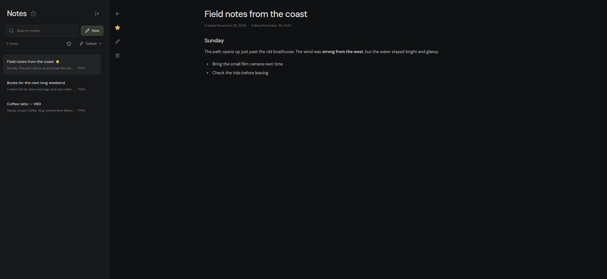

# Notes

Self hosted single-login markdown notes app.



## Run locally

```sh
# Generate env vars
cenv fix

# Run database
docker compose up -d

# Run migrations and app
pnpm i
pnpm db:migrate
pnpm dev

# Optional seeding
pnpm db:seed
```

## Deploy

```
ghcr.io/jesperkha/notes:latest
```

Required environment variables:

- `DATABASE_URL`: URL to postgres database
- `PASSWORD`: App password
